# Overview

This report answers the four midterm questions. Every concept is illustrated with
(a) a **real, published dataset**, (b) a hand computation that can be checked with a
calculator, and (c) the same computation carried out on **Apache Spark**
(PySpark, `pyspark.ml` / Spark MLlib). The Spark programs are submitted alongside this
report:

| Question | Spark program | Captured output | Real datasets used |
|---|---|---|---|
| Q1 Similarity measures | `code/q1_similarity.py` | `outputs/q1_similarity.txt` | MovieLens ratings (GroupLens) |
| Q2 Hypothesis testing | `code/q2_hypothesis_tests.py` | `outputs/q2_hypothesis_tests.txt` | UCBAdmissions, sleep, ToothGrowth, PlantGrowth |
| Q3 Clustering | `code/q3_clustering.py` | `outputs/q3_clustering.txt` | Iris, Old Faithful |
| Q4 Classification | `code/q4_classification.py` | `outputs/q4_classification.txt` | Play Tennis, Iris, Spambase (spam7) |

The data files are in `data/`, and their origins are listed in `data/SOURCES.md` and in
the References.

**Environment:** Apache Spark 4.0.1 (PySpark) in `local[*]` mode, Python 3.13 and
OpenJDK 21. The next section, **Spark Environment**, gives the full setup with
screenshots, and Appendix A has screenshots of every run. All numbers quoted below
are copied from the captured outputs.

\newpage

# Spark Environment

## Software and hardware

All four programs were run with `spark-submit` in Spark **local mode** (`local[*]`).
In local mode the driver and the executors run inside one JVM on one machine, using
every CPU core as a parallel task slot. The same code runs unchanged on a cluster
by changing the master URL, for example to YARN or Kubernetes.

| Component | Version / value |
|---|---|
| Apache Spark (PySpark) | 4.0.1, Scala 2.13.16 |
| Java | OpenJDK 21.0.12.1 (64-bit Server VM) |
| Python | 3.13.16 |
| SciPy / NumPy | 1.18.1 / 2.5.4 (p-value cross-checks only) |
| Operating system | Linux 6.18 x86_64 (virtual machine) |
| CPU cores / memory | 4 cores / 15 GB RAM |
| Spark master | `local[*]` (4 task slots) |
| Driver memory | 4 GB (`--driver-memory 4g`) |
| Event logging | enabled, viewed with the Spark History Server |

## Setup steps

```bash
# 1. Java 17 or 21 must be installed (java -version)
# 2. Create an isolated Python environment and install PySpark
python3 -m venv sparkenv && . sparkenv/bin/activate
pip install pyspark==4.0.1 scipy numpy
# 3. Turn on event logging so finished jobs can be inspected later
#    ($SPARK_CONF_DIR/spark-defaults.conf)
#      spark.eventLog.enabled         true
#      spark.eventLog.dir             file:///path/to/events
#      spark.history.fs.logDirectory  file:///path/to/events
# 4. Run each question
spark-submit --driver-memory 4g code/q1_similarity.py       > outputs/q1_similarity.txt
spark-submit --driver-memory 4g code/q2_hypothesis_tests.py > outputs/q2_hypothesis_tests.txt
spark-submit --driver-memory 4g code/q3_clustering.py       > outputs/q3_clustering.txt
spark-submit --driver-memory 4g code/q4_classification.py   > outputs/q4_classification.txt
# 5. Browse the finished applications at http://localhost:18080
$SPARK_HOME/sbin/start-history-server.sh
```

Q1 needs the 4 GB driver heap. With the default 1 GB, its MinHash similarity join
(about 1.4 million result pairs) failed with `java.lang.OutOfMemoryError: Java heap
space`, so the driver memory was raised.

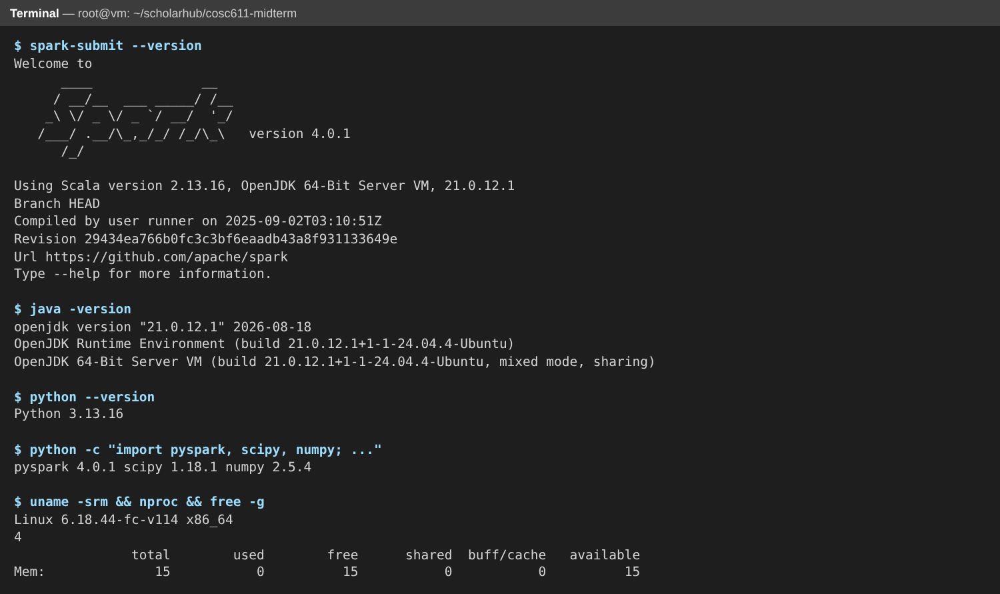{width=100%}

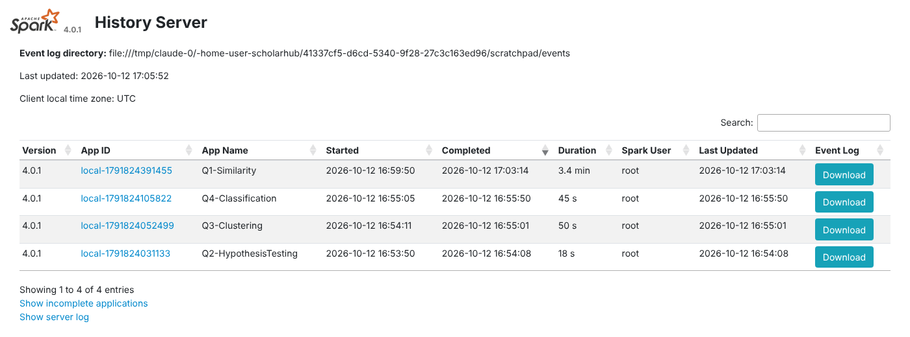{width=100%}

| Application | Question | Duration | Spark jobs |
|---|---|---|---|
| Q1-Similarity | 1 | 3.4 min | 71 |
| Q2-HypothesisTesting | 2 | 18 s | 137 |
| Q3-Clustering | 3 | 50 s | 983 |
| Q4-Classification | 4 | 45 s | 675 |

Every job in all four applications finished with status SUCCEEDED.

![Spark UI Environment page for the Q1 run: Java 21, Scala 2.13, spark.master = local[*], spark.driver.memory = 4g, event logging on](screenshots/03_q1_environment.png){width=100%}

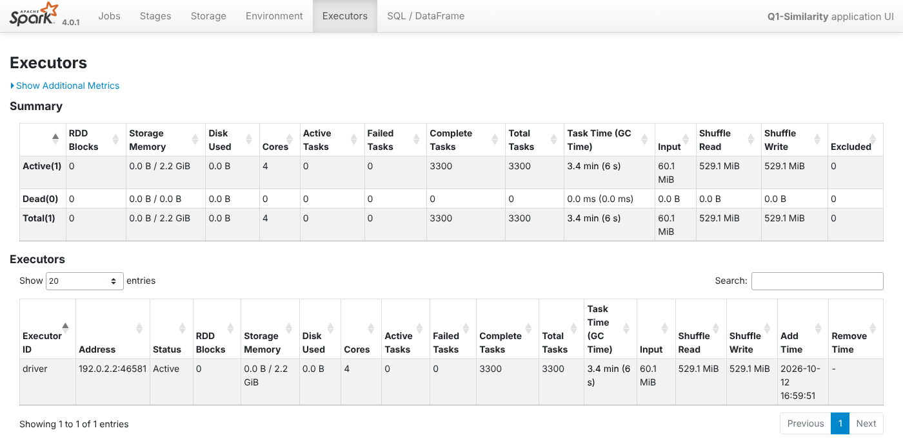{width=100%}

Screenshots of every question's console output and Spark jobs are in
**Appendix A**.

\newpage

# Question 1 — Similarity Measures

## 1.1 What is a similarity measure?

A **similarity measure** is a function $s(x, y)$ that takes two objects (two
customers, two documents, two images, two gene sequences, …) and returns a number
that says *how alike they are*. The higher the value, the more alike the objects are.
Its opposite is a **distance (dissimilarity) measure** $d(x, y)$, where a *smaller*
value means more alike. One can usually be turned into the other, for example
$s = \frac{1}{1+d}$ or $s = 1 - d$ when $d \in [0,1]$.

A good similarity measure usually has these properties:

* **Bounded/normalised**, often in $[0,1]$ or $[-1,1]$.
* **Symmetric**: $s(x,y) = s(y,x)$.
* **Maximal for identical objects**: $s(x,x)$ is the largest possible value.

A *distance metric* must also satisfy non-negativity, $d(x,y)=0 \iff x=y$, and the
triangle inequality $d(x,z) \le d(x,y)+d(y,z)$.

## 1.2 Why are similarity measures necessary?

Many Big Data analytics tasks come down to the question *"which items are close to
which?"*:

* **Recommender systems.** Collaborative filtering finds users whose rating vectors
  are similar to yours and recommends what they liked ("people like you also
  bought …").
* **Clustering.** K-Means, hierarchical clustering and DBSCAN group points that are
  close to each other (Question 3), so they need a distance.
* **Classification.** k-Nearest-Neighbours labels a point by the labels of its most
  similar neighbours. SVM kernels are similarity functions.
* **Information retrieval and search.** Search engines rank documents by their cosine
  similarity to the query vector (TF-IDF).
* **De-duplication and plagiarism detection.** Near-duplicate web pages and records
  are found with Jaccard similarity and MinHash.
* **Anomaly detection.** A point that is dissimilar to everything else is an outlier.

The right measure depends on the data type: numeric vectors, sets, text, or binary
attributes. A wrong choice gives misleading neighbours, as the example below shows.
At Big Data scale, comparing all $n^2$ pairs is too expensive, so Spark provides
**Locality-Sensitive Hashing (LSH)**. LSH finds similar pairs approximately without
comparing every pair.

## 1.3 Example data

The data is the **MovieLens** "latest-small" ratings dataset collected by GroupLens
at the University of Minnesota (Harper & Konstan, 2015), in the copy distributed with
the R package `dslabs`. It contains **100,004 ratings** (0.5–5 stars) by **671 users**
on **9,066 movies**.

For the hand computations, the program takes the **6 most-rated movies** and the
**first 5 users (by user ID) who rated at least 4 of them**. A 0 means the user did
not rate the movie.

| User | Forrest Gump | Pulp Fiction | Shawshank Redemption | Silence of the Lambs | Star Wars IV | Jurassic Park |
|---|---|---|---|---|---|---|
| user2 | 3.0 | 4.0 | 0 | 3.0 | 0 | 4.0 |
| user3 | 5.0 | 4.5 | 5.0 | 3.0 | 0 | 0 |
| user4 | 5.0 | 5.0 | 0 | 0 | 5.0 | 5.0 |
| user7 | 3.0 | 0 | 5.0 | 0 | 5.0 | 4.0 |
| user8 | 4.0 | 4.0 | 5.0 | 4.5 | 3.5 | 0 |

These movies were rated by 341, 324, 311, 304, 291 and 274 users respectively. In the
hand computations below, $x$ = user3 = (5, 4.5, 5, 3, 0, 0) and
$y$ = user8 = (4, 4, 5, 4.5, 3.5, 0).

Filling unrated movies with 0 is a common simplification. It treats "not rated" as
"disliked", which real recommender systems avoid by comparing only co-rated items
or by mean-centring.

## 1.4 Types of similarity measures, with computations

### (a) Euclidean distance (L2)

The straight-line distance between two points:
$$d_E(x,y)=\sqrt{\sum_i (x_i-y_i)^2}, \qquad s_E = \frac{1}{1+d_E}$$

$x-y = (1, 0.5, 0, -1.5, -3.5, 0)$, so
$d_E = \sqrt{1+0.25+0+2.25+12.25+0} = \sqrt{15.75} = 3.9686$ and
$s_E = 1/(1+3.9686) = 0.2013$.

Euclidean distance is sensitive to scale and magnitude. It is a natural fit for
dense, low-dimensional numeric data such as K-Means features.

### (b) Manhattan distance (L1, city-block)

$$d_M(x,y) = \sum_i |x_i-y_i|$$

$d_M = 1+0.5+0+1.5+3.5+0 = 6.5$. Manhattan distance is less affected by one large
difference than Euclidean distance, so it is more robust to outliers.

### (c) Cosine similarity

The cosine of the angle between two vectors. It measures orientation rather than
magnitude:
$$\cos(x,y)=\frac{x\cdot y}{\lVert x\rVert\,\lVert y\rVert}$$

* $x\cdot y = 20+18+25+13.5+0+0 = 76.5$
* $\lVert x\rVert = \sqrt{25+20.25+25+9}=\sqrt{79.25}=8.9022$
* $\lVert y\rVert = \sqrt{16+16+25+20.25+12.25}=\sqrt{89.5}=9.4604$
* $\cos(x,y) = 76.5/(8.9022\times9.4604) = 76.5/84.219 = \mathbf{0.9083}$

The range is $[-1,1]$, or $[0,1]$ for non-negative data. Cosine is the standard
measure for text (TF-IDF vectors) and for sparse, high-dimensional data such as a
user's ratings over 9,066 movies.

### (d) Pearson correlation coefficient

Cosine similarity applied after **mean-centring** each vector. This removes each
user's personal rating bias (a "harsh" rater versus a "generous" one):
$$r(x,y)=\frac{\sum_i (x_i-\bar x)(y_i-\bar y)}{\sqrt{\sum_i (x_i-\bar x)^2}\sqrt{\sum_i (y_i-\bar y)^2}}$$

* $\bar x = 17.5/6 = 2.9167$ and $\bar y = 21/6 = 3.5$
* Deviations: $x' = (2.083, 1.583, 2.083, 0.083, -2.917, -2.917)$ and
  $y' = (0.5, 0.5, 1.5, 1.0, 0, -3.5)$
* $\sum x'y' = 1.042+0.792+3.125+0.083+0+10.208 = 15.25$
* $\sum x'^2 = 28.208$ and $\sum y'^2 = 16$
* $r = 15.25/\sqrt{28.208\times16} = 15.25/21.245 = \mathbf{0.7178}$

The range is $[-1,1]$, where $-1$ means opposite tastes.

### (e) Jaccard similarity (sets)

Jaccard similarity is used when the data is a **set** or binary presence/absence
(which movies were rated, which genres a movie has, which words appear):
$$J(S,T)=\frac{|S\cap T|}{|S\cup T|}$$

* user3 rated {Forrest Gump, Pulp Fiction, Shawshank, Silence of the Lambs}.
* user8 rated those four plus Star Wars IV.
* Intersection = 4 and union = 5, so $J = 4/5 = 0.8$.

**Genre sets (real MovieLens genre labels):**

* The Matrix = {Action, Sci-Fi, Thriller}
* Jurassic Park = {Action, Adventure, Sci-Fi, Thriller}
* So $J = 3/4 = 0.75$.

Other measures for binary data include the **Simple Matching Coefficient**, which
also counts shared 0s, the **Hamming distance**, which counts positions that differ,
and the **Dice coefficient** $2|S\cap T|/(|S|+|T|)$. For text there is also **edit
(Levenshtein) distance**.

## 1.5 Computation on Spark

`code/q1_similarity.py` reads the 100,004 ratings with `spark.read.csv` and selects
the 5 × 6 matrix with DataFrame operations (`groupBy`, `orderBy`, `isin`). It then
**self cross-joins** the users to form every pair and evaluates each measure on the
pair. This is the distributed form of the $n^2$ comparison.

```python
a, b = df.alias("a"), df.alias("b")
pairs = a.crossJoin(b).where(F.col("a.user") < F.col("b.user"))
result = (pairs.withColumn("euclidean", euclidean("x", "y"))
               .withColumn("cosine", cosine("x", "y"))
               .withColumn("pearson", pearson("x", "y"))
               .withColumn("jaccard", jaccard("x", "y")) ...)
```

Spark output (all 10 pairs):

| u1 | u2 | Euclidean | 1/(1+d) | Manhattan | Cosine | Pearson | Jaccard |
|---|---|---|---|---|---|---|---|
| user2 | user3 | 6.7268 | 0.1294 | 11.5 | 0.6672 | 0.0528 | 0.6000 |
| user2 | user4 | 6.3246 | 0.1365 | 12.0 | 0.7778 | 0.3467 | 0.6000 |
| user2 | user7 | 8.6603 | 0.1035 | 17.0 | 0.4082 | −0.6801 | 0.3333 |
| user2 | user8 | 7.5166 | 0.1174 | 15.0 | 0.6204 | **−0.4504** | 0.5000 |
| user3 | user4 | 9.1788 | 0.0982 | 18.5 | 0.5336 | −0.3533 | 0.3333 |
| user3 | user7 | 8.6168 | 0.1040 | 18.5 | 0.5188 | −0.3483 | 0.3333 |
| user3 | user8 | **3.9686** | **0.2013** | **6.5** | **0.9083** | **0.7178** | **0.8000** |
| user4 | user7 | 7.4162 | 0.1188 | 13.0 | 0.6928 | 0.1115 | 0.6000 |
| user4 | user8 | 8.6313 | 0.1038 | 18.0 | 0.6078 | −0.5413 | 0.5000 |
| user7 | user8 | 7.4498 | 0.1183 | 15.0 | 0.6652 | −0.2413 | 0.5000 |

The Spark values match the hand computations for user3–user8 exactly.

The script also shows three **Spark-native** ways of computing these measures:

1. **Cosine via `Normalizer`.** `Normalizer(p=2.0)` scales every vector to unit
   length, so a plain dot product of two unit vectors *is* the cosine. Spark gives
   the same values, for example user3–user8 = 0.9083.
2. **Pearson via `pyspark.ml.stat.Correlation.corr`.** This computes the full
   correlation matrix in one distributed pass. (Spark correlates columns, so the
   matrix is transposed so that each user is a column.)

   ```
                user2   user3   user4   user7   user8
       user2    1.000   0.053   0.347  -0.680  -0.450
       user3    0.053   1.000  -0.353  -0.348   0.718
       user4    0.347  -0.353   1.000   0.111  -0.541
       user7   -0.680  -0.348   0.111   1.000  -0.241
       user8   -0.450   0.718  -0.541  -0.241   1.000
   ```
3. **Cosine nearest neighbours at full scale.** Each of the 671 users becomes a
   sparse vector over all movies, built with `groupBy` + `collect_list` and a
   `SparseVector`. After normalising, user8's vector is broadcast and dotted with
   every other user. The 5 most similar users to user8 out of all 670 are users
   520 (0.4403), 216 (0.4327), 562 (0.4294), 379 (0.4217) and 282 (0.4067). These
   scores are lower than in the 5-movie example because two users share only a
   small fraction of the 9,066 movies.

**Jaccard at scale: MinHash LSH on genre sets.** The script turns the genre list of
each of the 9,049 movies that have genres into a binary vector over the 19 genres
(`CountVectorizer(binary=True)`). The exact Jaccard similarities for five
well-known movies are:

| Movie 1 | Movie 2 | Jaccard |
|---|---|---|
| Jurassic Park | The Matrix | 0.7500 |
| Forrest Gump | Pulp Fiction | 0.3333 |
| The Matrix | Pulp Fiction | 0.1667 |
| Jurassic Park | Pulp Fiction | 0.1429 |
| Toy Story | Forrest Gump / Jurassic Park / Pulp Fiction | 0.1250 |
| Forrest Gump | The Matrix / Jurassic Park | 0.0 |

`MinHashLSH` hashes each set so that the probability that two sets get the same hash
*equals* their Jaccard similarity. Only pairs that collide in some hash table are
compared:

* `approxNearestNeighbors` for *The Matrix* returns six movies with exactly the
  same genres (Jaccard distance 0). In the recorded run these were *Predator*,
  *Predators*, *Johnny Mnemonic*, *eXistenZ*, *Next* and *Surrogates*. Many movies
  are tagged Action|Sci-Fi|Thriller, so all of them tie at distance 0, and which six
  are returned can change from run to run.
* `approxSimilarityJoin` with distance ≤ 0.2 (Jaccard ≥ 0.8) found
  **1,413,821** pairs without comparing all 40,937,676 pairs one by one.
* An exact brute-force check, also done in Spark, gives the same **1,413,821**, so
  the LSH recall is 1.0 here. Most of these pairs (1,406,827) are movies with
  identical genre sets, for example two movies labelled only "Drama".

## 1.6 Interpretation: the choice of measure matters

* For user8, every measure picks **user3** as the most similar user: the same
  movies, rated in a similar pattern.
* **user2 and user8** show why the measure matters. Their cosine similarity is
  fairly high (0.62), but their Pearson correlation is **negative (−0.45)**.
  Ratings are all non-negative, so the cosine of raw ratings is always ≥ 0. It
  mostly reflects that both users rate movies highly in general. Once each user's
  average is subtracted, Pearson shows that the two users *prefer different
  movies*.
* **Jaccard** ignores the ratings entirely and only uses *which* movies were
  rated. That makes it the right choice for genre sets, but it would call a lover
  and a hater of the same movies "identical".

In general:

* Use **cosine** for text and sparse vectors.
* Use **Pearson** for ratings with user bias.
* Use **Euclidean or Manhattan** for dense numeric features, after scaling them.
* Use **Jaccard** for sets or binary data.

\newpage

# Question 2 — Hypothesis Testing

## 2.1 What is hypothesis testing?

Hypothesis testing is a formal procedure for using **sample data** to decide whether
a claim about a **population** is supported. Analysts usually only see a sample, so
the question is whether an observed effect is real or could just be random sampling
noise. The steps are:

1. **State the hypotheses.** The *null hypothesis* $H_0$ is the "no effect / no
   difference / independent" claim. The *alternative hypothesis* $H_1$ is what we
   suspect is true.
2. **Choose the significance level** $\alpha$, usually 0.05. This is the probability
   of rejecting $H_0$ when it is actually true, called a **Type I error** (false
   positive). Failing to reject a false $H_0$ is a **Type II error** (false
   negative). The power of a test is $1-P(\text{Type II})$.
3. **Choose the test and compute the test statistic** (χ², t or F) from the sample.
4. **Find the p-value**: the probability, *assuming $H_0$ is true*, of seeing a
   statistic at least as extreme as the one observed. Equivalently, compare the
   statistic with a **critical value** from the statistic's distribution.
5. **Decide.** If $p < \alpha$, reject $H_0$ (the result is statistically
   significant). Otherwise, *fail to reject* $H_0$. Failing to reject does not
   prove $H_0$ true.

Tests can be **one-tailed** or **two-tailed**, depending on whether $H_1$
specifies a direction.

## 2.2 Distinguishing the χ², t and F tests

| | **Chi-square (χ²) test** | **Student's t-test** | **F-test** |
|---|---|---|---|
| Question answered | Are two *categorical* variables independent? Does an observed frequency distribution fit an expected one? | Is a *mean* different from a value, or are two *means* different? | Are two *variances* equal? Are 3 or more means equal (ANOVA)? |
| Data type | Counts/frequencies of categories | Continuous, approximately normal | Continuous, approximately normal |
| Statistic | $\chi^2=\sum \frac{(O-E)^2}{E}$ | $t=\frac{\bar x_1-\bar x_2}{s_p\sqrt{1/n_1+1/n_2}}$ | $F=\frac{s_1^2}{s_2^2}$, or $F=\frac{MS_{between}}{MS_{within}}$ |
| Distribution | χ² with $(r-1)(c-1)$ df | t with $n_1+n_2-2$ df (two-sample) or $n-1$ df (one-sample) | F with $(d_1,d_2)$ df |
| Shape | Right-skewed, values ≥ 0 | Symmetric bell, heavier tails than the normal | Right-skewed, values ≥ 0 |
| Parametric? | Non-parametric (no normality assumption) | Parametric | Parametric |
| Typical use | Survey answers vs demographic; click vs device | A/B test of average spend; before/after | Comparing variability of processes; ANOVA across many groups; overall significance of a regression |
| Spark support | `pyspark.ml.stat.ChiSquareTest` (built in) | No built-in test. Computed from distributed aggregates (mean, var, count) | `ANOVATest` and `FValueTest` (`org.apache.spark.ml.stat`), or from aggregates |

**How they relate.** $t^2$ with $\nu$ df equals $F$ with $(1, \nu)$ df, so a
two-group ANOVA is the same test as a two-sample t-test. The χ² distribution is the
distribution of a sum of squared standard normals, and $F$ is a ratio of two scaled
χ² variables.

## 2.3 Chi-square test of independence — UC Berkeley admissions

**Data.** `UCBAdmissions` records the 4,526 applicants to the six largest graduate
departments at UC Berkeley in Fall 1973, by gender and admission decision
(Bickel, Hammel & O'Connell, 1975). Summed over the departments:

| Observed | Admitted | Rejected | Row total |
|---|---|---|---|
| Male | 1198 | 1493 | 2691 |
| Female | 557 | 1278 | 1835 |
| Column total | 1755 | 2771 | N = 4526 |

$H_0$: admission is independent of gender. $H_1$: they are associated.

**Hand computation.** The expected count for each cell is
$E = \frac{\text{row total}\times\text{column total}}{N}$:

| Cell | O | E | (O−E)²/E |
|---|---|---|---|
| Male, Admitted | 1198 | 2691·1755/4526 = 1043.461 | 22.8875 |
| Male, Rejected | 1493 | 2691·2771/4526 = 1647.539 | 14.4957 |
| Female, Admitted | 557 | 1835·1755/4526 = 711.539 | 33.5642 |
| Female, Rejected | 1278 | 1835·2771/4526 = 1123.461 | 21.2578 |

$$\chi^2 = 22.8875+14.4957+33.5642+21.2578 = \mathbf{92.21}$$

The degrees of freedom are $(2-1)(2-1)=1$, and the critical value is
$\chi^2_{0.05,1}=3.8415$. Since $92.21 \gg 3.84$, **reject $H_0$**: overall, 44.5% of
men but only 30.4% of women were admitted.

**Spark.** `groupBy().pivot()` builds the table, and a groupBy/join pipeline
reproduces the $(O-E)^2/E$ column above. For MLlib's built-in test, each frequency
row is expanded into one row per applicant with `explode(sequence(1, Freq))`, which
gives 4,526 rows:

```python
r = ChiSquareTest.test(vec, "features", "label").head()
# Spark ChiSquareTest: statistic = 92.2053, df = 1, p-value = 0.000e+00
# scipy check:          statistic = 92.2053, p-value = 7.814e-22
```

Spark prints the p-value as 0 because the true value, $7.8\times10^{-22}$, is
below the precision of its χ² tail computation. SciPy gives the exact figure.

**Simpson's paradox.** Running the same Spark `ChiSquareTest` *inside each
department* reverses the story:

| Dept | Male admit rate | Female admit rate | χ² | p-value | Decision |
|---|---|---|---|---|---|
| A | 0.621 | 0.824 | 17.248 | <0.0001 | Reject H₀ (favours women) |
| B | 0.630 | 0.680 | 0.254 | 0.6145 | Fail to reject |
| C | 0.369 | 0.341 | 0.754 | 0.3854 | Fail to reject |
| D | 0.331 | 0.349 | 0.298 | 0.5852 | Fail to reject |
| E | 0.277 | 0.239 | 1.001 | 0.3171 | Fail to reject |
| F | 0.059 | 0.070 | 0.384 | 0.5354 | Fail to reject |

Women mostly applied to departments with low admission rates (C–F). The overall
association is real, but it is explained by *department*, a confounding variable,
not by bias within departments. This was the conclusion of Bickel et al. (1975). A
significant χ² shows association, not cause.

## 2.4 Student's t-test — the sleep data

**Data.** `sleep` is the dataset that W. S. Gosset ("Student") used in the 1908
paper that introduced the t-test. It is taken from Cushny & Peebles (1905). Ten
patients each received two sleep-inducing drugs, and the extra hours of sleep
compared with a control were recorded:

| Patient | 1 | 2 | 3 | 4 | 5 | 6 | 7 | 8 | 9 | 10 |
|---|---|---|---|---|---|---|---|---|---|---|
| Drug 1 | 0.7 | −1.6 | −0.2 | −1.2 | −0.1 | 3.4 | 3.7 | 0.8 | 0.0 | 2.0 |
| Drug 2 | 1.9 | 0.8 | 1.1 | 0.1 | −0.1 | 4.4 | 5.5 | 1.6 | 4.6 | 3.4 |
| Difference | −1.2 | −2.4 | −1.3 | −1.3 | 0.0 | −1.0 | −1.8 | −0.8 | −4.6 | −1.4 |

$H_0$: $\mu_1 = \mu_2$. $H_1$: $\mu_1 \ne \mu_2$ (two-tailed).

**(a) Independent two-sample t-test (pooled variance).**

* $\bar x_1 = 0.75$, $s_1^2 = 3.2006$; $\bar x_2 = 2.33$, $s_2^2 = 4.0090$
* Pooled variance: $s_p^2 = \frac{9(3.2006)+9(4.0090)}{18} = 3.6048$
* Standard error: $SE = \sqrt{3.6048(1/10+1/10)} = 0.8491$
* $t = (0.75-2.33)/0.8491 = \mathbf{-1.8608}$, with $df = 18$

The critical value is $t_{0.025,18} = 2.1009$ and $p = 0.0792$. Since
$|t| < 2.1009$, we **fail to reject $H_0$**.

**(b) Paired t-test.** The *same* ten patients took both drugs, so the correct
analysis uses the ten differences $d_i$:

* $\bar d = -1.58$ and $s_d = 1.2300$
* $t = \bar d/(s_d/\sqrt{n}) = -1.58/(1.23/\sqrt{10}) = \mathbf{-4.0621}$, with $df = 9$

The critical value is $t_{0.025,9} = 2.2622$ and $p = 0.0028$, so we **reject
$H_0$**: drug 2 gives more extra sleep.

The two versions reach opposite conclusions on the same data. The paired test
removes the large patient-to-patient variability, which the independent test
wrongly treats as noise. Choosing the test that matches the study design is part of
hypothesis testing.

**Spark.** MLlib has no t-test class, but the test only needs counts, means and
sample variances. These come from **one distributed aggregation**:
`groupBy("group").agg(count, mean, var_samp)` for (a), and
`pivot` + `mean`/`stddev_samp` of the differences for (b). Only the final scalar
formula and the t-distribution tail probability run on the driver:

```
(a) Spark-computed t = -1.8608, df = 18, p = 0.07919   | scipy: t = -1.8608, p = 0.07919
(b) Spark-computed t = -4.0621, df = 9,  p = 0.002833  | scipy: t = -4.0621, p = 0.002833
```

## 2.5 F-test

### (a) F-test for equality of two variances — ToothGrowth

**Data.** `ToothGrowth` (Crampton, 1947) gives the length of odontoblasts (the cells
responsible for tooth growth) in 60 guinea pigs. Each received vitamin C either as
orange juice (OJ, n = 30) or as ascorbic acid (VC, n = 30).

$H_0$: $\sigma_{OJ}^2 = \sigma_{VC}^2$. $H_1$: $\sigma_{OJ}^2 \ne \sigma_{VC}^2$.

* Spark aggregates give $s_{OJ}^2 = 43.633$ and $s_{VC}^2 = 68.327$.
* $F = 43.633/68.327 = \mathbf{0.6386}$, with $df = (29, 29)$.
* The two-tailed critical values are $F_{0.025;29,29}=0.4760$ and
  $F_{0.975;29,29}=2.1010$.
* $p = 0.2331$.

Since $0.476 < 0.6386 < 2.101$, we **fail to reject $H_0$**: there is no evidence
that the two supplement types give different variability. Equal variances are one
of the assumptions of the pooled t-test and of ANOVA, so this F-test is often run
first as a check.

### (b) One-way ANOVA F-test — PlantGrowth

**Data.** `PlantGrowth` (Dobson, 1983) records the dried weight of 30 plants: 10
controls and 10 under each of two treatments.

| Group | Weights | Mean |
|---|---|---|
| ctrl | 4.17, 5.58, 5.18, 6.11, 4.50, 4.61, 5.17, 4.53, 5.33, 5.14 | 5.032 |
| trt1 | 4.81, 4.17, 4.41, 3.59, 5.87, 3.83, 6.03, 4.89, 4.32, 4.69 | 4.661 |
| trt2 | 6.31, 5.12, 5.54, 5.50, 5.37, 5.29, 4.92, 6.15, 5.80, 5.26 | 5.526 |

$H_0$: $\mu_{ctrl}=\mu_{trt1}=\mu_{trt2}$. $H_1$: at least one mean differs.

**Hand computation.** The grand mean is $5.073$.

* $SSB = 10[(5.032-5.073)^2+(4.661-5.073)^2+(5.526-5.073)^2] = 10(0.00168+0.16974+0.20521) = 3.7663$
* $SSW = \sum_g\sum_i (x_{gi}-\bar x_g)^2 = 9(0.33999+0.62992+0.19587) = 10.4921$
* $MSB = 3.7663/2 = 1.8832$ and $MSW = 10.4921/27 = 0.3886$
* $F = 1.8832/0.3886 = \mathbf{4.846}$, with $df = (2, 27)$

The critical value is $F_{0.05;2,27} = 3.354$ and $p = 0.0159$, so **reject
$H_0$**: the treatments affect plant weight. Treatment 2 has the highest mean and
treatment 1 the lowest.

**Spark.** The ANOVA table is computed with DataFrame aggregations, and Spark's
`org.apache.spark.ml.stat.ANOVATest` is also called. That class has no Python
wrapper in PySpark 4.0, so the script calls it through the JVM gateway:

```python
jdf = spark._jvm.org.apache.spark.ml.stat.ANOVATest.test(anova_df._jdf, "features", "label")
# Spark ANOVATest: F = 4.8461, df = (2, 27), p-value = 0.01591
# scipy check:     F = 4.8461, p-value = 0.01591
```

## 2.6 Summary of results

| Test | Dataset | Statistic | df | p-value | Critical value (α=0.05) | Decision |
|---|---|---|---|---|---|---|
| χ² independence | UCBAdmissions | 92.21 | 1 | 7.8×10⁻²² | 3.84 | Reject H₀ |
| Two-sample t (pooled) | sleep | −1.86 | 18 | 0.0792 | ±2.10 | Fail to reject H₀ |
| Paired t | sleep | −4.06 | 9 | 0.0028 | ±2.26 | Reject H₀ |
| F (variances) | ToothGrowth | 0.639 | (29, 29) | 0.2331 | 0.476 / 2.101 | Fail to reject H₀ |
| ANOVA F | PlantGrowth | 4.846 | (2, 27) | 0.0159 | 3.354 | Reject H₀ |

\newpage

# Question 3 — Supervised vs Unsupervised Learning, and Clustering

## 3.1 Supervised versus unsupervised learning

| | **Supervised learning** | **Unsupervised learning** |
|---|---|---|
| Training data | **Labelled**: each example $x$ comes with the correct answer $y$ | **Unlabelled**: only $x$ is given |
| Goal | Learn a mapping $f: x \to y$ that predicts labels or values for new data | Discover hidden *structure*: groups, density, low-dimensional representation, associations |
| Feedback | An error signal against known labels (loss) | No "right answer". Quality is judged by internal criteria (cohesion and separation) or by a domain expert |
| Typical tasks | Classification (spam/not spam), regression (house price) | Clustering (customer segments), dimensionality reduction (PCA), association rules (market basket), anomaly detection |
| Example algorithms | Naïve Bayes, SVM, Random Forest, logistic and linear regression, neural networks | K-Means, Bisecting K-Means / hierarchical, Gaussian Mixture, DBSCAN, PCA, FP-Growth |
| Evaluation | Accuracy, precision/recall, F1, AUC, RMSE on a held-out test set | Within-cluster SSE, silhouette score, log-likelihood, visual inspection |
| Cost of data | Labels are often expensive (human annotation) | Raw data is cheap and plentiful, which suits Big Data |
| Spark MLlib | `pyspark.ml.classification`, `pyspark.ml.regression` | `pyspark.ml.clustering`, `pyspark.ml.feature.PCA`, `pyspark.ml.fpm` |

An analogy: supervised learning is like studying with an answer key. Unsupervised
learning is like being handed a pile of documents and asked to sort them into
sensible piles without being told what the piles should be. Semi-supervised and
reinforcement learning sit between these two.

## 3.2 Example data

**Iris** (Anderson, 1935; Fisher, 1936) contains 150 iris flowers, 50 from each of
three species: *setosa*, *versicolor* and *virginica*. Each flower has four
measurements in cm: sepal length, sepal width, petal length and petal width. The
species means are:

| Species | Sepal L | Sepal W | Petal L | Petal W |
|---|---|---|---|---|
| setosa | 5.006 | 3.428 | 1.462 | 0.246 |
| versicolor | 5.936 | 2.770 | 4.260 | 1.326 |
| virginica | 6.588 | 2.974 | 5.552 | 2.026 |

The algorithms see **only the four measurements**. The species label is held back
and used only afterwards, to check how well each algorithm discovered the true
groups. This is a standard way to evaluate an unsupervised method on data where the
answer happens to be known.

**Old Faithful** (R `faithful`; Härdle, 1991; see also Azzalini & Bowman, 1990)
records 272 eruptions of the Old Faithful geyser in Yellowstone National Park:
eruption duration and waiting time, in minutes. It is used below to show soft
clustering with a Gaussian Mixture.

All algorithms run in `code/q3_clustering.py`, with `VectorAssembler` building the
feature vector and `ClusteringEvaluator` (silhouette) used for evaluation.

## 3.3 Algorithm 1 — K-Means (partitional, hard clustering)

**Idea.** K-Means splits the data into $k$ clusters. It chooses $k$ centroids that
minimise the within-cluster sum of squared errors,
$WSSSE=\sum_{j=1}^{k}\sum_{x\in C_j}\lVert x-\mu_j\rVert^2$, by repeating two steps
(Lloyd's algorithm):

1. **Assign**: put each point in the cluster of its nearest centroid (Euclidean
   distance, from Q1).
2. **Update**: move each centroid to the mean of its assigned points.

These two steps repeat until the assignments stop changing. Spark initialises the
centroids with **k-means||**, a parallel version of k-means++, and each iteration is
one map (assign) plus one reduce (sum the points per cluster). This makes K-Means a
natural fit for MapReduce and Spark.

**Hand computation (one iteration, k = 2).** The four flowers are iris rows 1 and 44
(setosa) and rows 51 and 78 (versicolor), using petal length and width. The initial
centroids are C1 = flower 1 and C2 = flower 51.

| Flower (petal L, W) | d(C1) | d(C2) | Assigned |
|---|---|---|---|
| 1 (1.4, 0.2) | 0 | √(3.3²+1.2²) = 3.5114 | C1 |
| 44 (1.6, 0.6) | √(0.2²+0.4²) = 0.4472 | √(3.1²+0.8²) = 3.2016 | C1 |
| 51 (4.7, 1.4) | 3.5114 | 0 | C2 |
| 78 (5.0, 1.7) | √(3.6²+1.5²) = 3.9000 | √(0.3²+0.3²) = 0.4243 | C2 |

The new centroids are C1 = mean(flower 1, flower 44) = **(1.5, 0.4)** and
C2 = mean(flower 51, flower 78) = **(4.85, 1.55)**. Recomputing the distances does not
change any assignment, so the algorithm has converged. The script prints these
exact numbers.

**Choosing k (elbow method + silhouette), computed with Spark on all 150 flowers:**

| k | WSSSE | Silhouette |
|---|---|---|
| 2 | 152.348 | **0.8504** |
| **3** | **78.851** | 0.7357 |
| 4 | 57.256 | 0.6723 |
| 5 | 52.945 | 0.6158 |
| 6 | 39.354 | 0.5479 |

WSSSE roughly halves from k = 2 to k = 3 and then decreases much more slowly: the
"elbow" is at k = 3. The silhouette is highest at k = 2, because *versicolor* and
*virginica* overlap and form one well-separated blob next to *setosa*. The two
criteria disagree, which is common on real data. Domain knowledge (three species)
settles it, so **k = 3**.

**Spark result (`KMeans(k=3, seed=1)`, converged in 3 iterations):**

| Cluster | Centroid (sepal L, sepal W, petal L, petal W) | setosa | versicolor | virginica |
|---|---|---|---|---|
| 0 | (5.902, 2.748, 4.394, 1.434) | 0 | **48** | 14 |
| 1 | (5.006, 3.428, 1.462, 0.246) | **50** | 0 | 0 |
| 2 | (6.850, 3.074, 5.742, 2.071) | 0 | 2 | **36** |

WSSSE = 78.851 and silhouette = 0.7357. The **purity** is 134/150 = **0.8933**:
setosa is found perfectly, and the 16 errors are versicolor/virginica flowers in the
region where the two species overlap.

**Strengths and weaknesses.** K-Means is simple, fast ($O(nkt)$) and scales well.
However, you must choose $k$ in advance, and it assumes spherical clusters of
similar size. It is also sensitive to outliers and to feature scale, and it gives
only hard assignments.

## 3.4 Algorithm 2 — Bisecting K-Means (hierarchical, divisive)

**Idea.** Bisecting K-Means is a **top-down hierarchical** method:

1. Start with all points in one cluster.
2. Pick a cluster to split (Spark splits divisible clusters level by level,
   preferring the larger ones).
3. Split it into two with ordinary 2-means.
4. Repeat until there are $k$ leaf clusters or no cluster can be divided.

The result is a binary **tree (dendrogram)** of clusters, so you can cut it at
different levels. Each split only runs 2-means on a subset of the data, so it is
often faster than K-Means for large $k$. It is also less dependent on random
initialisation.

**How the hierarchy unfolds on Iris** (centre = sepal L, sepal W, petal L, petal W):

| k | Clusters (centre, size) |
|---|---|
| 2 | (5.01, 3.37, 1.56, 0.29) n=53 · (6.30, 2.89, 4.96, 1.70) n=97 |
| 3 | (5.01, 3.37, 1.56, 0.29) n=53 · (5.95, 2.77, 4.45, 1.45) n=59 · (6.85, 3.07, 5.74, 2.07) n=38 |

The first cut separates the small-petal flowers (setosa plus 3 others) from all the
rest. The second cut splits the large group of 97 into a medium-petal and a
large-petal cluster. Each cut is an ordinary 2-means like the hand computation in
3.3.

**Spark result (`BisectingKMeans(k=3, seed=1)`):**

| Cluster | setosa | versicolor | virginica |
|---|---|---|---|
| 0 | **50** | 3 | 0 |
| 1 | 0 | **45** | 14 |
| 2 | 0 | 2 | **36** |

SSE = 84.204, silhouette = 0.7232 and purity = 131/150 = **0.8733**. This is
slightly worse than K-Means (SSE 78.851). The first split put 3 versicolor flowers
in the setosa branch, and **bisecting never undoes an earlier split**. That greedy
behaviour is the method's main weakness.

**Strengths and weaknesses.** Bisecting K-Means gives a hierarchy and needs fewer
distance computations per step. Bad early splits are never corrected. Classic
*agglomerative* (bottom-up) hierarchical clustering needs $O(n^2)$ memory and does
not scale, which is why Spark offers the divisive version.

## 3.5 Algorithm 3 — Gaussian Mixture Model (probabilistic, soft clustering)

**Idea.** A GMM assumes the data was generated by $k$ Gaussian distributions with
mixing weights $\pi_j$, means $\mu_j$ and covariance matrices $\Sigma_j$:
$$p(x)=\sum_{j=1}^{k}\pi_j\,\mathcal N(x\mid\mu_j,\Sigma_j)$$
The parameters are estimated by **Expectation-Maximisation (EM)**:

* **E-step**: compute each point's *responsibility*, the probability that it
  belongs to each component:
  $\gamma_{ij}=\frac{\pi_j\mathcal N(x_i\mid\mu_j,\Sigma_j)}{\sum_l\pi_l\mathcal N(x_i\mid\mu_l,\Sigma_l)}$.
* **M-step**: re-estimate $\pi_j$, $\mu_j$ and $\Sigma_j$ as responsibility-weighted
  averages.
* Repeat until the log-likelihood stops improving.

Unlike K-Means, every point gets a **probability of membership** in every cluster
(soft clustering). The full covariance matrices also allow **elliptical** clusters
of different sizes and orientations. K-Means is the special case of a GMM with equal
spherical covariances and hard assignments.

**Initialisation matters.** EM only reaches a *local* optimum, so the script fits 10
random initialisations:

| Seeds | Log-likelihood | Cluster sizes | Note |
|---|---|---|---|
| 3, 4, 7 | −180.19 | 50 / 55 / 45 | the solution kept |
| 10 | −189.50 | 53 / 47 / 50 | |
| 1, 9 | −192.65 | 24 / 50 / 76 | |
| 2 | −193.21 | 29 / 50 / 71 | |
| 5, 8 | −194.64 | 13 / 50 / 87 | rejected: a component holds < 10% |
| 6 | **−133.69** | 49 / **3** / 98 | rejected: a component holds < 10% |

Seed 6 has by far the *highest* likelihood but is a **degenerate** solution. One
Gaussian collapsed onto 3 flowers, and its nearly singular covariance makes the
density, and so the likelihood, very large. This is a known failure mode of EM for
GMMs. The script keeps the highest-likelihood fit in which every component holds at
least 10% of the data.

**Spark result (`GaussianMixture(k=3, seed=7)`):**

| Component | Weight | Mean (sepal L, sepal W, petal L, petal W) | setosa | versicolor | virginica |
|---|---|---|---|---|---|
| 0 | 0.333 | (5.006, 3.428, 1.462, 0.246) | **50** | 0 | 0 |
| 1 | 0.368 | (6.545, 2.949, 5.480, 1.985) | 0 | 5 | **50** |
| 2 | 0.299 | (5.915, 2.778, 4.202, 1.297) | 0 | **45** | 0 |

The log-likelihood is −180.19 and the silhouette is 0.6503. The purity is
145/150 = **0.9667**, the best of the three algorithms. Its full covariances fit the
elongated, overlapping versicolor and virginica groups better than K-Means'
spheres. The silhouette score is lower because silhouette itself assumes compact,
round clusters.

**Soft memberships.** Nine flowers have a maximum membership probability below 0.95,
and all of them lie in the versicolor/virginica overlap. For example:

| Flower | Species | Petal L, W | P(comp 0) | P(comp 1) | P(comp 2) |
|---|---|---|---|---|---|
| 78 | versicolor | 5.0, 1.7 | 0.000 | **0.671** | 0.329 |
| 134 | virginica | 5.1, 1.5 | 0.000 | **0.784** | 0.216 |
| 85 | versicolor | 4.5, 1.5 | 0.000 | 0.153 | **0.847** |

K-Means would give each of these one hard label. The GMM reports that the
assignment is uncertain.

**Old Faithful: a hand-checkable E-step.** The script fits a 2-component GMM to the
272 eruption durations:

| Component | Mean (min) | Variance | Weight |
|---|---|---|---|
| 0 ("short") | 2.0186 | 0.0555 | 0.3484 |
| 1 ("long") | 4.2733 | 0.1910 | 0.6516 |

For an eruption lasting $x = 2.8$ minutes:

* $\pi_0\,\mathcal N(2.8\mid2.0186,0.0555) = 0.3484\times0.006927 = 0.002414$
* $\pi_1\,\mathcal N(2.8\mid4.2733,0.1910) = 0.6516\times0.003110 = 0.002026$
* $\gamma_0 = 0.002414/(0.002414+0.002026) = \mathbf{0.5436}$, which matches Spark.

| Eruption (min) | 1.8 | 2.8 | 3.0 | 3.2 | 4.5 |
|---|---|---|---|---|---|
| P(short) | 1.0000 | **0.5436** | 0.0117 | 0.0001 | 0.0000 |
| P(long) | 0.0000 | **0.4564** | 0.9883 | 0.9999 | 1.0000 |

A 2.8-minute eruption is close to a coin flip between the two eruption types.
Only 12 of the 272 eruptions fall between 2.5 and 3.5 minutes.

## 3.6 Comparison of the three algorithms

| | K-Means | Bisecting K-Means | Gaussian Mixture |
|---|---|---|---|
| Type | Partitional, centroid-based | Hierarchical (divisive) | Model-based, probabilistic |
| Assignment | Hard | Hard | **Soft** (probabilities) |
| Cluster shape | Spherical, similar size | Spherical | Elliptical, any size and orientation |
| Objective | Minimise WSSSE | Repeated 2-means splits | Maximise likelihood (EM) |
| Output | k centroids | Tree of clusters + centroids | Weights, means, covariances |
| Cost | Low | Low to medium | Higher (covariance per component) |
| Sensitivity | Initialisation, outliers, scale | Early greedy splits | Initialisation; can collapse to a few points |
| Iris (k=3): SSE / WSSSE | 78.85 | 84.20 | — |
| Iris (k=3): silhouette | 0.7357 | 0.7232 | 0.6503 |
| Iris (k=3): purity vs species | 0.8933 | 0.8733 | **0.9667** |

\newpage

# Question 4 — Classification

## 4.1 What is classification?

**Classification** is a *supervised* learning task. It learns, from labelled
training examples $(x_i, y_i)$, a function that assigns a new observation $x$ to
one of a fixed set of **discrete classes** $y\in\{c_1,\dots,c_m\}$. Examples:

* Is an email spam or ham?
* Is a transaction fraudulent?
* Will it rain tomorrow?
* Which digit (0–9) is in this image?

The workflow is:

1. Collect labelled data.
2. Engineer the features (`VectorAssembler`, `StringIndexer`, `OneHotEncoder`,
   scaling).
3. Split the data into training and test sets.
4. **Train** the model.
5. **Predict** on the test set.
6. **Evaluate** with a confusion matrix, accuracy, precision, recall, F1 and ROC-AUC.

A *binary* problem has two classes and a *multiclass* problem has more. Regression
is different: it predicts a *continuous* value.

## 4.2 The three algorithms in words

**Naïve Bayes** is a **probabilistic, generative** classifier based on Bayes'
theorem:
$$P(c\mid x)=\frac{P(c)\,P(x\mid c)}{P(x)} \;\propto\; P(c)\prod_{j}P(x_j\mid c)$$
It is "naïve" because it assumes the features are conditionally independent given
the class, so the joint likelihood becomes a product of one-feature terms. Training
is just counting (for categorical or multinomial data) or estimating a mean and
variance per class and feature (Gaussian NB). This takes a single pass over the
data, which is extremely fast and scalable. **Laplace smoothing** adds 1 to each
count so that an unseen value does not make the whole product zero.

**Support Vector Machine (SVM)** is a **geometric, discriminative** classifier. It
finds the **hyperplane** $w\cdot x+b=0$ that separates the classes with the
**largest margin** $2/\lVert w\rVert$. Only the points that lie on the margin, the
**support vectors**, determine the boundary. The **soft-margin** version allows
some violations through the hinge loss
$\max(0, 1-y(w\cdot x+b))$ plus a regularisation term $\lambda\lVert w\rVert^2$.
The **kernel trick** (polynomial, RBF) handles non-linear boundaries. Spark MLlib
provides a distributed **linear** SVM (`LinearSVC`) trained with OWL-QN.

**Random Forest** is an **ensemble of decision trees**, an example of bagging:

* Each tree is trained on a **bootstrap sample** (rows drawn with replacement).
* At each split, a tree considers only a **random subset of features**.
* Each split is chosen to reduce impurity the most, measured by Gini
  $=1-\sum_c p_c^2$ or by entropy.
* The forest predicts by **majority vote** of the trees, or by averaging their
  class probabilities.

The two kinds of randomness make the trees different from one another, so their
errors partly cancel out. This reduces variance and overfitting compared with a
single tree, and the forest also yields **feature importances**. Spark trains all
the trees in parallel.

## 4.3 Worked example A — "Play Tennis" (hand computation + Spark)

The training data is the classic 14-day weather table of Quinlan (1986), as printed
in Mitchell (1997, Table 3.2). It records outlook, temperature and humidity, and the
label *play* (9 Yes, 5 No); the table's Wind column is omitted here. The task is to classify a new day: **Outlook = Sunny,
Temp = Cool, Humidity = High**.

### Naïve Bayes by hand

| | Yes | No |
|---|---|---|
| Prior P(c) | 9/14 | 5/14 |
| P(Sunny \| c) | 2/9 | 3/5 |
| P(Cool \| c) | 3/9 | 1/5 |
| P(High \| c) | 3/9 | 4/5 |
| **Product** | 9/14 · 2/9 · 3/9 · 3/9 = **0.01587** | 5/14 · 3/5 · 1/5 · 4/5 = **0.03429** |
| Posterior (normalised) | 0.3165 | **0.6835** |

The prediction is **No (don't play)**. Spark computes every conditional count with
DataFrame filters and gets exactly these numbers. Spark's `NaiveBayes`
(multinomial, one-hot features, Laplace smoothing = 1) gives P(No) = 0.6379, which
is also **No**. The probability is slightly different because smoothing pulls the
estimates towards uniform.

### Random Forest building block: Gini split selection, by hand and on Spark

The root node has 9 Yes and 5 No, so
$Gini = 1-(9/14)^2-(5/14)^2 = 0.4592$.

| Candidate split | Child nodes (Yes/No) | Weighted Gini | Gain |
|---|---|---|---|
| **Outlook** | Sunny (2/3): 0.48, Overcast (4/0): 0, Rain (3/2): 0.48 | **0.3429** | **0.1163** |
| Humidity | High (3/4): 0.490, Normal (6/1): 0.245 | 0.3673 | 0.0918 |
| Temp | Hot (2/2): 0.5, Mild (4/2): 0.444, Cool (3/1): 0.375 | 0.4405 | 0.0187 |

A single tree would split on **Outlook** first. In a Random Forest, each tree only
sees a bootstrap sample and a random subset of features, so different trees split
differently. A 7-tree `RandomForestClassifier` on Spark voted
**[No, No, Yes, Yes, No, No, No]**: 5 votes against 2 for **No**. The forest's
probability is P(No) = 0.701, which agrees with Naïve Bayes.

### SVM on real data: Iris setosa vs versicolor

The data is the 100 Iris flowers of the *setosa* (label 0) and *versicolor*
(label 1) species, described by petal length and petal width. These two species do
not overlap:

| Species | Petal length (cm) | Petal width (cm) |
|---|---|---|
| setosa | 1.0 – 1.9 | 0.1 – 0.6 |
| versicolor | 3.0 – 5.1 | 1.0 – 1.8 |

So a straight line can separate them, which is the setting where the SVM's
maximum-margin idea is easiest to see.

Spark `LinearSVC(regParam=0.001, standardization=False)` learned the hyperplane:
$$0.8125\cdot\text{petal\_len} + 1.7249\cdot\text{petal\_wid} - 3.3350 = 0$$
with margin width $2/\lVert w\rVert = 2/\sqrt{0.8125^2+1.7249^2} = 2/1.9067 = \mathbf{1.0489}$ cm.

**Hand check of the decision function** $f(x)=w\cdot x+b$:

* Flower 1 (setosa, petal 1.4, 0.2): $0.8125(1.4)+1.7249(0.2)-3.3350 = 1.1375+0.3450-3.3350 = \mathbf{-1.8525} < 0$, so **setosa** ✓
* Flower 51 (versicolor, petal 4.7, 1.4): $0.8125(4.7)+1.7249(1.4)-3.3350 = 3.8188+2.4149-3.3350 = \mathbf{+2.8988} > 0$, so **versicolor** ✓

**Support vectors.** The flowers closest to the boundary are flower 44 (setosa,
1.6, 0.6) with $f(x) = -1.0000$ and flower 99 (versicolor, 3.0, 1.1) with
$f(x) = +1.0000$. They lie exactly on the two margin lines $w\cdot x+b=\pm1$, so they
are the support vectors that fix the boundary. Moving any flower farther from the
boundary would not change the model. Training accuracy is 100%.

Spark's `LinearSVC` minimises the regularised hinge loss
$\frac1n\sum\max(0,1-y_i(w\cdot x_i+b))+\frac{\lambda}{2}\lVert w\rVert^2$ with the OWL-QN
quasi-Newton method. This is the soft-margin SVM. With a small $\lambda$ it
approaches the hard-margin solution, but it does not solve the exact quadratic
program that a textbook SVM uses.

## 4.4 Worked example B — real spam e-mail, all three classifiers on Spark

**Data.** `spam7` contains **4,601 real e-mails** from the UCI *Spambase*
collection, gathered at Hewlett-Packard Labs (Hopkins, Reeber, Forman &
Suermondt, 1999). This copy, from the R package `DAAG`, keeps six of the original
57 features:

| Feature | Meaning |
|---|---|
| `crl_tot` | total length of all runs of CAPITAL letters |
| `dollar` | % of characters that are "\$" |
| `bang` | % of characters that are "!" |
| `money` | % of words that are "money" |
| `n000` | % of words that are "000" |
| `make` | % of words that are "make" |

There are 2,788 ham and 1,813 spam e-mails (39.4% spam). The class means show the
signal:

| class | crl_tot | dollar | bang | money | n000 | make |
|---|---|---|---|---|---|---|
| ham (0) | 161.5 | 0.012 | 0.110 | 0.017 | 0.007 | 0.073 |
| spam (1) | 470.6 | 0.174 | 0.514 | 0.213 | 0.247 | 0.152 |

The data is split 70/30 (`randomSplit(seed=42)`) into 3,288 training and 1,313 test
e-mails. All models are Spark ML `Pipeline`s:

```python
NaiveBayes(modelType="gaussian")                                  # raw features
NaiveBayes(modelType="gaussian") on log(1 + x) features           # see below
Pipeline([StandardScaler(withMean=True, withStd=True), LinearSVC(regParam=0.01)])
RandomForestClassifier(numTrees=100, maxDepth=8, seed=42)
```

**Test-set results (from `outputs/q4_classification.txt`):**

| Model | Accuracy | F1 | Precision (spam) | Recall (spam) | ROC-AUC |
|---|---|---|---|---|---|
| Naïve Bayes (Gaussian, raw features) | 0.7685 | 0.7482 | **0.9170** | 0.4748 | 0.8564 |
| Naïve Bayes (Gaussian, log(1+x) features) | 0.8180 | 0.8104 | 0.8957 | 0.6262 | 0.8947 |
| Linear SVM | 0.8363 | 0.8307 | 0.9040 | 0.6692 | 0.9058 |
| **Random Forest (100 trees)** | **0.8842** | **0.8832** | 0.8948 | **0.8112** | **0.9248** |

ROC-AUC is computed from each model's spam *score*: the class-1 probability for NB
and RF, and the signed distance $w\cdot x+b$ for the SVM, which has no probability
output.

**Confusion matrices (rows = actual, columns = predicted), 778 ham and 535 spam in the test set:**

| | NB raw: ham | NB raw: spam | NB log: ham | NB log: spam | SVM: ham | SVM: spam | RF: ham | RF: spam |
|---|---|---|---|---|---|---|---|---|
| actual ham | 755 | 23 | 739 | 39 | 740 | 38 | 727 | 51 |
| actual spam | 281 | 254 | 200 | 335 | 177 | 358 | 101 | 434 |

**What each fitted model learned:**

* **Naïve Bayes** stores class priors (0.611 ham, 0.389 spam) and, for every class
  and feature, a mean and variance. For example, the mean `crl_tot` is 163.9 for ham
  and 467.1 for spam. Gaussian NB assumes each feature is *normally* distributed
  within a class, but these counts and percentages are mostly 0 with a long right
  tail. The badly fitting Gaussians make NB cautious: it misses 281 of 535 spams
  (recall 0.47). Taking $\log(1+x)$ makes the features less skewed and raises
  accuracy from 0.769 to 0.818. **Checking the model's assumptions matters.**
* **SVM** learned one hyperplane on the standardised features, with weights
  dollar 1.181, money 0.990, bang 0.935, n000 0.820, crl_tot 0.007, make −0.022 and
  $b = 0.098$. A linear boundary cannot capture thresholds such as "any `$` at all
  is suspicious", which limits its recall.
* **Random Forest** fits non-linear, axis-aligned rules and handles the skewed
  features without any transformation. Its feature importances are bang 0.375,
  dollar 0.318, crl_tot 0.123, money 0.116, n000 0.052, make 0.016: "!" and "\$"
  are the strongest spam signals. It has the best accuracy, recall and AUC, and its
  errors are the most balanced (51 false alarms, 101 missed spams).

**Where the models disagree.** The three classifiers (NB on raw features, SVM and RF)
disagree on 270 of the 1,313 test e-mails. The first three that the script prints
are spams with weak signals, such as `crl_tot = 112, dollar = 0.054, bang = 0.164`.
NB and SVM call them ham and only the forest catches them. A tree can learn that
small but non-zero values of `$` and `!` already indicate spam.

**Interpretation.** On this real data, the features are skewed, the class boundary
is non-linear, and the features interact, so the ensemble wins. NB has the highest
precision (few false alarms) and is the cheapest to train, which matters for a
spam filter that must not lose real mail. The SVM sits in between.

## 4.5 Distinguishing Naïve Bayes, SVM and Random Forest

| Aspect | **Naïve Bayes** | **SVM** | **Random Forest** |
|---|---|---|---|
| Family | Probabilistic, **generative** (models $P(x\mid c)$) | Geometric, **discriminative** (models the boundary) | **Ensemble** of decision trees (bagging) |
| Core principle | Bayes' theorem + conditional independence | Maximum-margin separating hyperplane | Majority vote of de-correlated trees |
| Decision boundary | Linear (multinomial) or quadratic (Gaussian) | Linear; non-linear with kernels | Piecewise axis-aligned, highly non-linear |
| Training | One pass of counting (very fast) | Convex optimisation (iterative) | Grow many trees in parallel (heavier) |
| Key hyperparameters | Smoothing, model type | C / regParam, kernel | numTrees, maxDepth, featureSubsetStrategy |
| Output | Calibrated-ish class probabilities | Signed distance / score (no native probability) | Vote fractions as probabilities + feature importance |
| Feature scaling needed? | No | **Yes** (distance-based) | No |
| Handles feature interactions | No (independence assumption) | Only via kernels | **Yes**, naturally |
| Robustness | Works with little data; hurt by correlated features | Robust in high dimensions; sensitive to C and scaling | Robust to outliers and noise; resists overfitting |
| Interpretability | High (inspect probabilities) | Medium (weights for linear) | Medium (feature importances, but many trees) |
| Best for | Text and spam, real-time, very high-dimensional sparse data | High-dimensional data with a clear margin (text, bioinformatics) | Tabular data with mixed types and non-linear effects |
| Spark MLlib class | `NaiveBayes` (multinomial, Bernoulli, Gaussian, complement) | `LinearSVC` (binary, linear) | `RandomForestClassifier` |
| Result on Play Tennis query | No (P = 0.684) | — | No (5 of 7 trees) |
| Spam (spam7) test accuracy / AUC | 0.769 / 0.856 (0.818 / 0.895 with log features) | 0.836 / 0.906 | **0.884 / 0.925** |

\newpage

# Appendix A — Execution Screenshots

The figures below come from the `spark-submit` runs described in the Spark
Environment section. The terminal figures are excerpts of each program's console
output; "..." marks lines left out to save space. The full output of each run is in
`outputs/`. The Spark UI figures are from the Spark History Server, which reads each
run's event log.

## Question 1 — Similarity measures

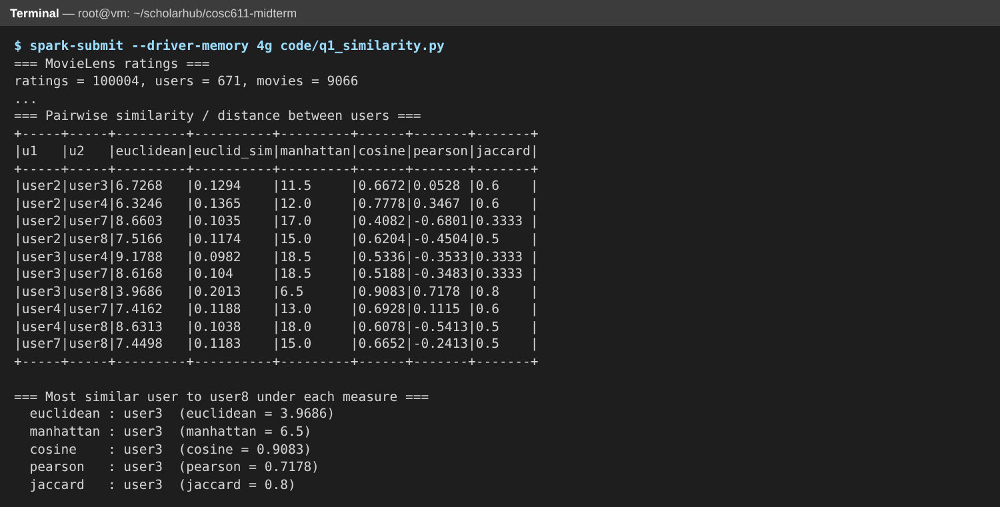{width=100%}

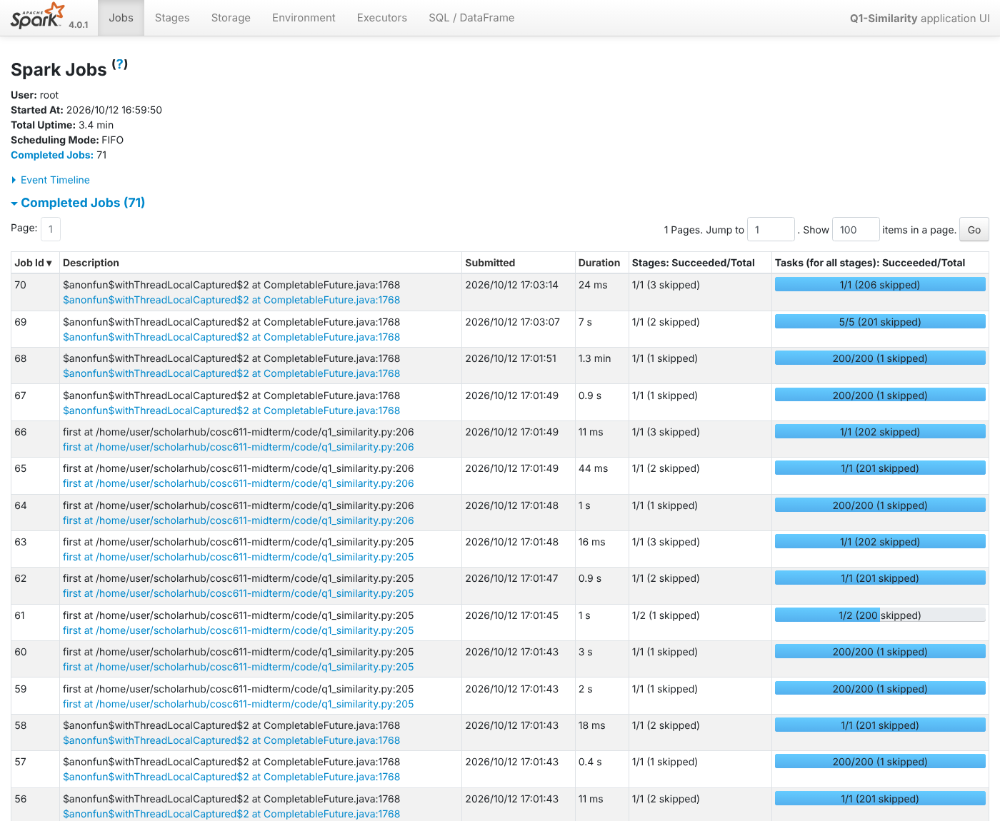{width=100%}

## Question 2 — Hypothesis testing

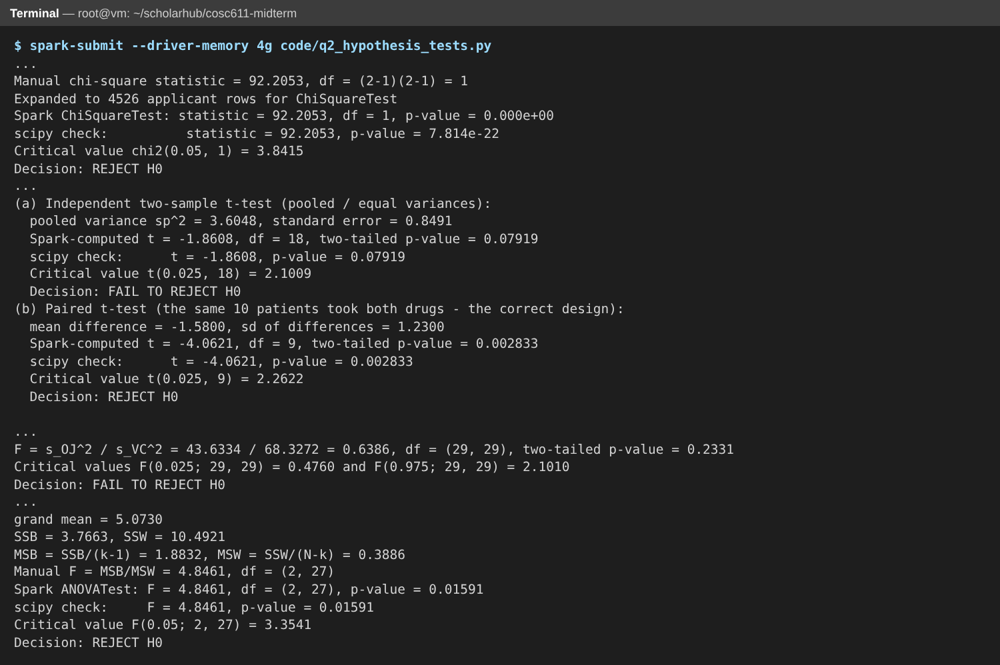{width=100%}

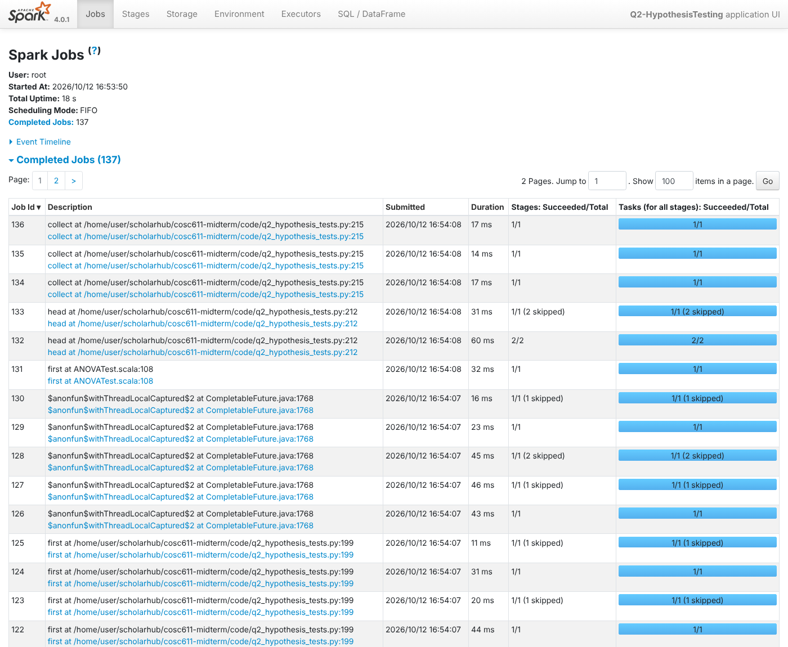{width=100%}

## Question 3 — Clustering

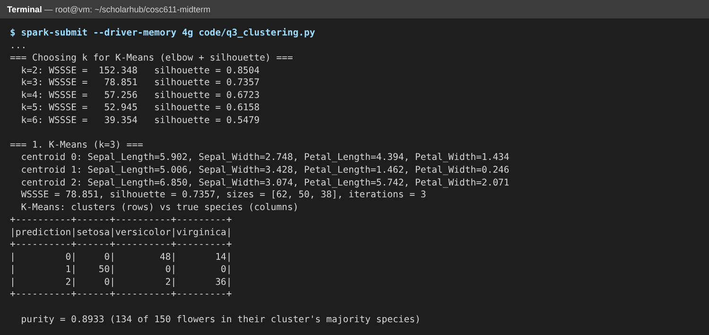{width=100%}

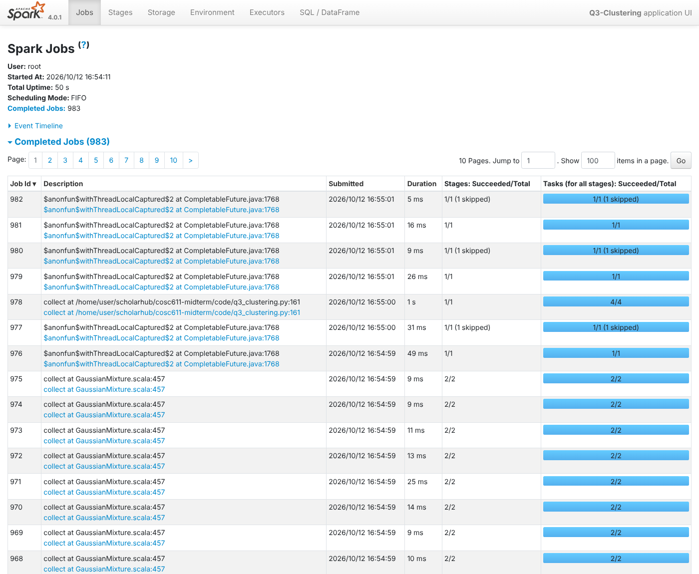{width=100%}

## Question 4 — Classification

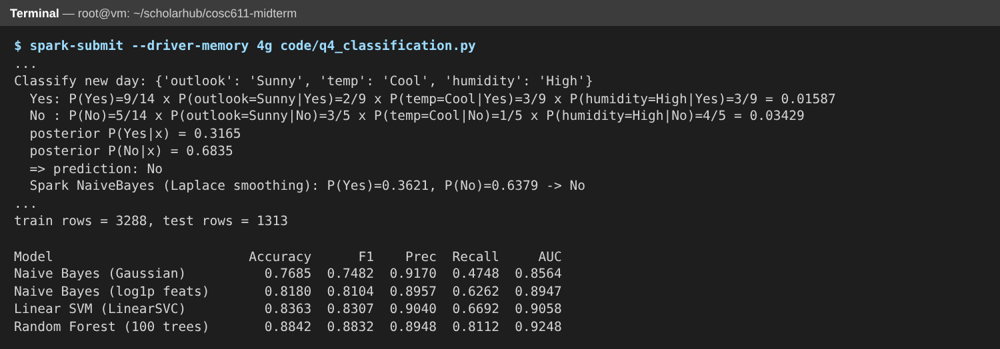{width=100%}

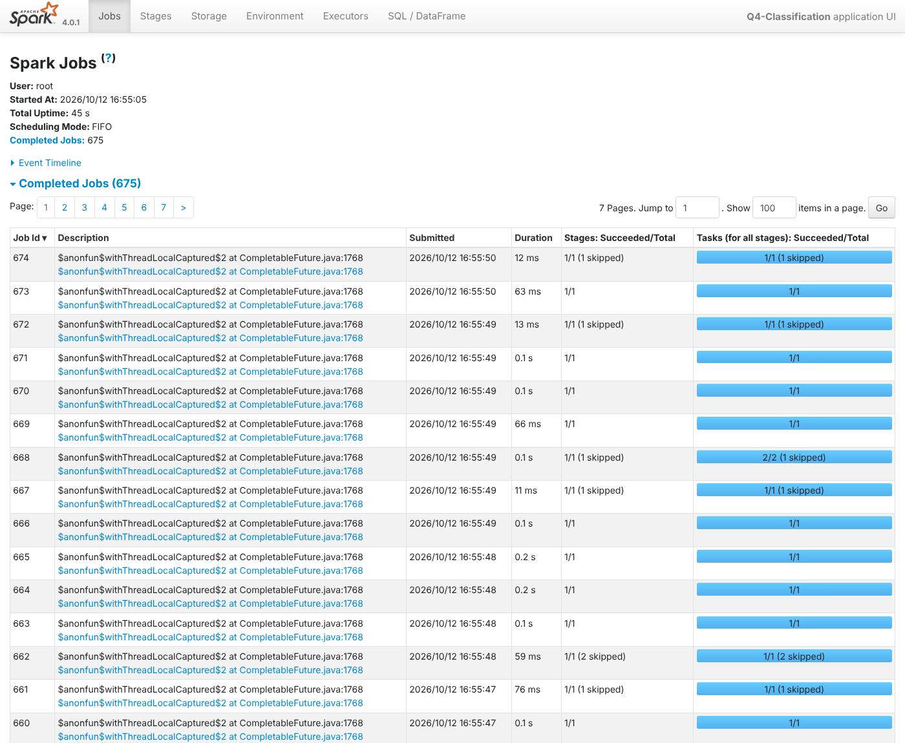{width=100%}

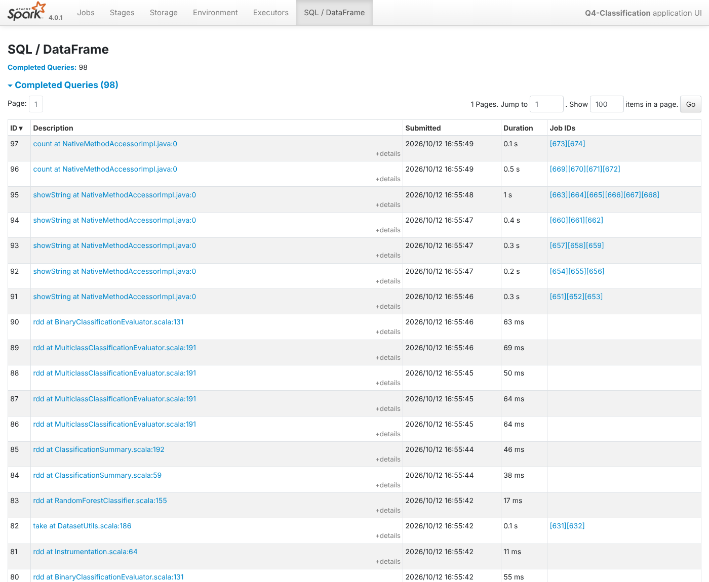{width=100%}

\newpage

# References

**Software and documentation**

1. Apache Spark. *MLlib: Main Guide — Basic Statistics (Correlation, Hypothesis
   testing, ChiSquareTest), Clustering, Classification and Regression, Feature
   Extraction (MinHash LSH)*. Spark 4.0 documentation.
   https://spark.apache.org/docs/latest/ml-guide.html
2. Apache Spark. *PySpark API Reference — pyspark.ml*.
   https://spark.apache.org/docs/latest/api/python/reference/pyspark.ml.html
3. Virtanen, P. et al. (2020). SciPy 1.0: Fundamental algorithms for scientific
   computing in Python. *Nature Methods*, 17, 261–272. (Used to cross-check
   p-values.)
4. Arel-Bundock, V. *Rdatasets: A collection of datasets originally distributed in
   R packages*. https://vincentarelbundock.github.io/Rdatasets/ (Source of the CSV
   copies in `data/`.)

**Textbooks and methods**

5. Leskovec, J., Rajaraman, A., & Ullman, J. D. (2020). *Mining of Massive
   Datasets* (3rd ed.), Ch. 3 (Finding Similar Items, Jaccard, MinHash, LSH) and
   Ch. 7 (Clustering). Cambridge University Press. http://www.mmds.org
6. Han, J., Kamber, M., & Pei, J. (2012). *Data Mining: Concepts and Techniques*
   (3rd ed.), Ch. 2 (Measuring Data Similarity and Dissimilarity), Ch. 8–9
   (Classification), Ch. 10 (Cluster Analysis). Morgan Kaufmann.
7. Tan, P.-N., Steinbach, M., Karpatne, A., & Kumar, V. (2018). *Introduction to
   Data Mining* (2nd ed.). Pearson. (Bisecting K-Means.)
8. Montgomery, D. C., & Runger, G. C. (2014). *Applied Statistics and Probability
   for Engineers* (6th ed.), Ch. 9–10 (Tests of Hypotheses, χ², t, F) and Ch. 13
   (ANOVA). Wiley.
9. Mitchell, T. M. (1997). *Machine Learning*, Table 3.2 and Ch. 6 (Bayesian
   Learning). McGraw-Hill.
10. Cortes, C., & Vapnik, V. (1995). Support-vector networks. *Machine Learning*,
    20(3), 273–297.
11. Breiman, L. (2001). Random forests. *Machine Learning*, 45(1), 5–32.
12. Dempster, A. P., Laird, N. M., & Rubin, D. B. (1977). Maximum likelihood from
    incomplete data via the EM algorithm. *Journal of the Royal Statistical
    Society B*, 39(1), 1–38.

**Datasets**

13. Harper, F. M., & Konstan, J. A. (2015). The MovieLens datasets: History and
    context. *ACM Transactions on Interactive Intelligent Systems*, 5(4), Article 19.
    (MovieLens "latest-small" ratings, as distributed in the R package `dslabs`,
    Irizarry & Gill.)
14. Bickel, P. J., Hammel, E. A., & O'Connell, J. W. (1975). Sex bias in graduate
    admissions: Data from Berkeley. *Science*, 187(4175), 398–404.
    (`UCBAdmissions`)
15. Student [W. S. Gosset] (1908). The probable error of a mean. *Biometrika*,
    6(1), 1–25; data from Cushny, A. R., & Peebles, A. R. (1905). The action of
    optical isomers II: Hyoscines. *Journal of Physiology*, 32, 501–510. (`sleep`)
16. Crampton, E. W. (1947). The growth of the odontoblasts of the incisor tooth as a
    criterion of the vitamin C intake of the guinea pig. *Journal of Nutrition*,
    33(5), 491–504. (`ToothGrowth`)
17. Dobson, A. J. (1983). *An Introduction to Statistical Modelling*. Chapman and
    Hall. (`PlantGrowth`)
18. Anderson, E. (1935). The irises of the Gaspé Peninsula. *Bulletin of the
    American Iris Society*, 59, 2–5; Fisher, R. A. (1936). The use of multiple
    measurements in taxonomic problems. *Annals of Eugenics*, 7(2), 179–188.
    (`iris`)
19. Härdle, W. (1991). *Smoothing Techniques with Implementation in S*. Springer;
    Azzalini, A., & Bowman, A. W. (1990). A look at some data on the Old Faithful
    geyser. *Applied Statistics*, 39(3), 357–365. (`faithful`)
20. Hopkins, M., Reeber, E., Forman, G., & Suermondt, J. (1999). *Spambase* [Data
    set]. UCI Machine Learning Repository. https://doi.org/10.24432/C53G6X; subset
    `spam7` from Maindonald, J. H., & Braun, W. J., R package `DAAG`.
21. Quinlan, J. R. (1986). Induction of decision trees. *Machine Learning*, 1,
    81–106. (Play Tennis data, as printed in Mitchell (1997), Table 3.2; the Wind
    attribute is omitted here.)
